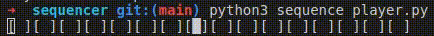

# sequencer
| :warning: **WARNING**: for the safety of your ears and hardware, please set your volume to low before playing! |
| --- |

Python sequencer that runs in your terminal



## Dependencies
- Python 3
- inquirer (pip3 install inquirer)
- sox (for audio processing)

## Usage

To start the sequencer with the interactive TUI:
```bash
python3 tui.py
```

### Controls
## 🎛 Controls

### 🎹 Sequencer View
*   **Navigation**: `ARROWS` to move cursor.
*   **Toggle Step**: `SPACE`
*   **Edit Note**: `[` / `]` to change pitch, `{` / `}` to change octave (Synths only).
*   **Mute Track**: `M`
*   **Solo Track**: `L`

### 🎚 Mixer View (`TAB` to toggle)
*   **Navigation**: `ARROWS` to select parameters.
*   **Adjust Value**: `[` / `]`
*   **Switch Waveform**: Select `Type` column and use `[` / `]` (Saw, Square, Sine, Triangle).
*   **Mute/Solo**: `M` / `L`

### 🌍 Global Controls
*   **Save Settings**: `S` (Saves to `settings.json`)
*   **BPM**: `+` / `-`
*   **Global Pitch**: `W` / `S` (+/- 100 cents)
*   **Global Speed**: `D` / `A` (+/- 10%)
*   **Quit**: `Q`

## Legacy Mode
To run without the TUI (just audio playback):
```bash
python3 sequence_player.py
```

## To add more sounds
- Add your sample file in the samples folder
  - mp3 playback should be a little faster since the files are more compressed, but feel free to try other file types
- Add you sample file name and settings in the settings.json file

## Sound effects
All sound effects are based on sox [checkout the sox documentation for more info](http://sox.sourceforge.net/sox.html)

## [SoX Cheatsheet](./documentation/SOX_CHEATSHEET.md)

## [Future updates](./documentation/FUTURE_FEATURES.md)